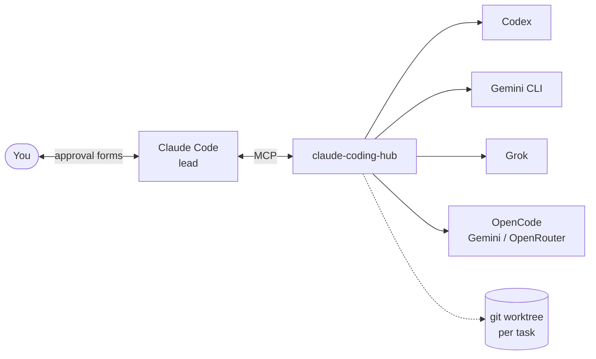
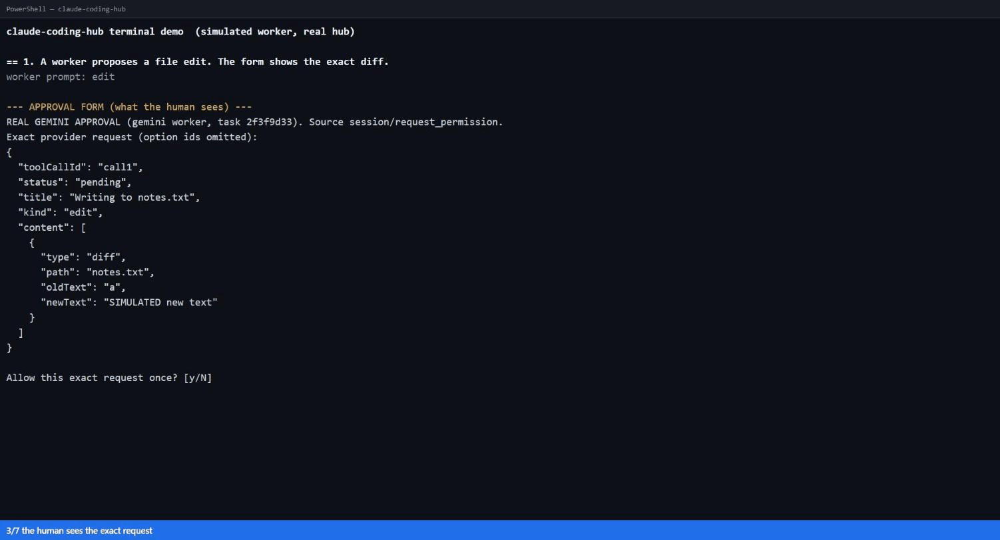

# claude-coding-hub

**Let Claude Code hand work to other coding agents, without letting any of them act on their own.**

A local [MCP](https://modelcontextprotocol.io) server. Claude Code is the lead engineer; Codex, Gemini CLI, Grok and OpenCode models are bounded workers. Each worker gets its own git worktree, a filtered environment and a hub-owned home. Every risky action it asks for becomes **one human decision, on the exact request**, or an error. The lead model cannot approve anything.



## Try it in 30 seconds (no accounts)

```powershell
npm ci
npm run build
npm run demo
```



*A replay of real `npm run demo` output.*

A simulated worker runs through the real hub and **you** answer its approval forms in the terminal. The second scenario is the interesting one: the worker asks to run a shell command described only in its own words, and the hub refuses it before you are ever asked. See [why](docs/threat-model.md#finding-acp-permission-prompts-are-not-a-uniform-trust-boundary).

## What makes it different

- **The human decides, not the model.** There is no `approve` tool. Approvals are MCP form elicitations answered in the client's UI, so a prompt-injected lead has nothing to call.
- **Deny stops the task.** A refusal ends the whole run so the worker cannot rephrase its way past it.
- **Show the real action or show nothing.** A permission prompt is forwarded only if it carries the exact command or diff. Gemini CLI's does not for shell commands (its title can be a model-written description), so those are refused. [Details](docs/threat-model.md).
- **The hub's own git is attack-resistant.** A worker can rewrite `.git/hooks` or its `.git` pointer; the hub pins the gitdir it recorded before the worker started and disables hooks. Plain git is exploited by the same tests.
- **Fails closed on drift.** Each adapter reads back the provider's effective permissions, MCP servers and approval mode, and stops before inference if they differ from what it asked for.
- **Auditable.** Every request, decision and state change is stored in SQLite and survives restarts (`get_task_history`).

## Workers

| `provider` | Agent | Verified against the real CLI |
|---|---|---|
| `codex` | Codex | Real run, real approve and decline |
| `opencode` | OpenCode + Gemini | Real run, real approve and decline |
| `gemini` | Gemini CLI (edits only) | Handshake and isolated start only |
| `openrouter` | OpenCode + OpenRouter | Simulated agent only |
| `grok` | Grok Build | Handshake only |

Setup, credentials and per-worker notes: [docs/providers.md](docs/providers.md).

## Use it for real

Prerequisites: Windows, Node 22.13+, [Claude Code](https://claude.com/claude-code), and at least one worker CLI signed in.

```powershell
npm.cmd run build
npm.cmd test                       # 65 tests, about 90 seconds
npm.cmd run smoke                  # one bounded real Codex run
.\scripts\start-pilot.ps1          # Claude lead + the hub, in the disposable fixture
```

The launcher writes only `.local/mcp.json`, starts Claude in `fixtures/pilot`, and changes no global settings. Use `/mcp` in Claude to confirm `coding_hub` is connected.

### On a real repository, in parallel

```powershell
.\scripts\start-pilot.ps1 -Repo C:\path\to\your\repo -MaxWorkers 3
```

Each `start_worker` creates a worktree on a new `hub/<id>` branch, so workers never touch your checkout or each other. The flow is `start_worker → wait_for_worker → get_worker_diff → commit_worker_changes`, then you merge. The hub only ever commits to the worker's own branch.

## Status

This is a feasibility pilot, not a product. Plainly:

- **Phone approval does not work.** Claude Remote Control paired with an iPhone, but MCP approval forms never rendered there. Approvals happen in the desktop or terminal client. ([results](docs/phone-results.md), [checklist](docs/phone-testing.md))
- **Three workers are unverified against their real CLIs**: `gemini`, `openrouter` and `grok` pass tests against simulated agents only. The real Gemini key on the development machine was rejected by Google, and Grok has no non-interactive login.
- **OpenCode, Gemini and Grok have no OS sandbox.** Once you approve an action it runs as you. Only Codex runs in a sandbox. See [residual risk](docs/threat-model.md#residual-risk-honest-list).
- **Symlink refusal has no dedicated test.**
- **Windows-first.** Process cleanup uses `taskkill`; the tests are not run on other platforms.
- **Pinned to today's CLIs.** Codex 0.163 alpha, OpenCode 1.19, Gemini CLI 0.65, Grok 1.0.70. Checks fail closed on drift, but expect to re-verify after upgrades.
- **Local models (Ollama) are not supported**, deliberately. [Why](docs/providers.md#local-models-ollama-not-supported-on-purpose).

## Documentation

- [Threat model](docs/threat-model.md): attacks, defences, the test for each, and what remains
- [Architecture](docs/architecture.md): lifecycle, one decision end to end, how to add a worker
- [Workers](docs/providers.md): setup and what is verified
- [Limitations](docs/limitations.md), [compatibility record](docs/compatibility.md), [phone results](docs/phone-results.md), [phone checklist](docs/phone-testing.md)
- [AGENTS.md](AGENTS.md): rules for coding agents working on this repo (which files are off limits and why)

## License

[MIT](LICENSE)
