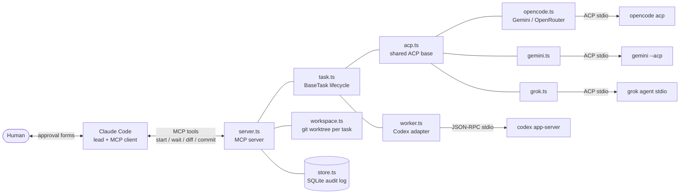
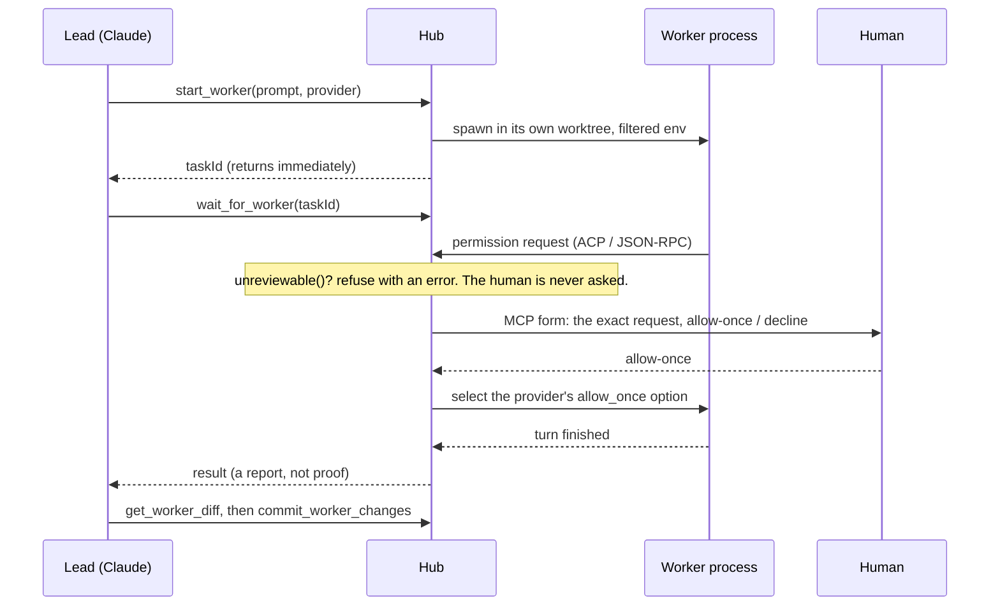

# Architecture

The hub is a local [MCP](https://modelcontextprotocol.io) server. A lead agent (Claude Code) calls its tools; the hub starts worker agents as child processes, translates each vendor's protocol into one task lifecycle, and routes every risky decision to the human.

## The one rule that shapes everything

**A worker's request becomes either an error or exactly one human decision.** There is no third path where the hub or the lead model decides. Every adapter inherits this from `BaseTask`:

- a decision is answered at most once, and never after the task is finished;
- declining, cancelling or failing stops the whole task and invalidates every pending request;
- the workspace stays *busy* until the worker's process tree is confirmed dead.

## One decision, end to end

The lead never sees a tool that approves. `wait_for_worker` is where forms are raised, because that is a call the client can interrupt and answer in its own UI.

## Files

| File | Responsibility | Size |
|---|---|---|
| `src/server.ts` | MCP tools, the approval form, provider registry | small |
| `src/task.ts` | `BaseTask`: state machine, one-shot decisions, process-tree cleanup, the env allowlist | small |
| `src/acp.ts` | Shared Agent Client Protocol plumbing and the `unreviewable()` hook | small |
| `src/worker.ts` | Codex app-server adapter and its login/sandbox/MCP-inventory checks | medium |
| `src/opencode.ts` | OpenCode adapter; profiles for Google and OpenRouter | medium |
| `src/gemini.ts`, `src/grok.ts` | Adapters built on `acp.ts` | small |
| `src/workspace.ts` | One git worktree and `hub/*` branch per task; hook- and pointer-proof host git | small |
| `src/store.ts` | SQLite task and event log; survives restarts | small |

Task states: `starting → running ⇄ waiting_for_user → completed | failed | cancelled | denied`. A task that was live when the hub died is reported `interrupted` on restart; it is never silently resumed.

## Repo mode

With `HUB_REPO_ROOT` set, each task gets `git worktree add` on a fresh `hub/<id>` branch off the repo's current HEAD. The flow is `start_worker → wait_for_worker → get_worker_diff → commit_worker_changes → (you merge) → remove_worker_workspace`. The hub commits only to the worker's own branch. Merging is yours.

Host-side git runs outside the worker's sandbox on a folder the worker can edit, so it pins the gitdir recorded before the worker started and disables hooks, fsmonitor and diff drivers (`src/workspace.ts`). Plain git is exploitable here, and the tests demonstrate it.

## Adding a worker

For anything that speaks ACP, extend `AcpTask` and implement three things:

1. `prepare()`: refuse unsafe setups (project config in the task folder, a dirty provider home), then return the command, args and a **filtered** environment.
2. `unreviewable(toolCall)`: return a reason for any request whose exact action you cannot show the human. This is where a provider's weaknesses get decided; read its source, do not assume.
3. Optionally `authenticate()` and `checkSession()` to read back the mode the provider actually started in.

Then register one line in the `providers` map in `server.ts`, and add tests against a fake agent (see `tests/fake-acp.mjs`). For a non-ACP protocol, extend `BaseTask` directly, as `worker.ts` does for Codex.

## Design decisions

- **Forms, not a model-facing approve tool.** If the lead could call `approve`, a prompt-injected lead could approve. MCP form elicitation puts the answer in the client's UI.
- **Deny stops everything.** Letting a worker continue after a refusal invites rephrasing until something slips through.
- **Fail closed on drift.** Each adapter reads back the provider's effective config (permissions, MCP servers, plugins, model) and stops before inference if it differs. Vendor CLIs change; the hub should stop, not guess.
- **Hub-owned homes.** Providers pick up config from the user's home (skills, hooks, permission rules, even other tools' settings). Redirecting the home is cheaper and stronger than enumerating what to disable.
- **Small enough to audit.** No framework: two npm dependencies (`@modelcontextprotocol/sdk`, `zod`) plus Node's built-in SQLite.
